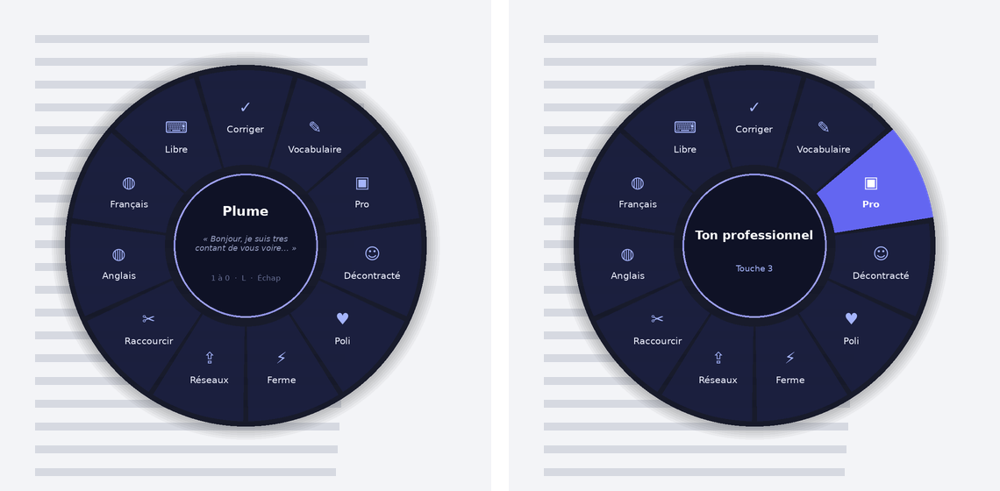
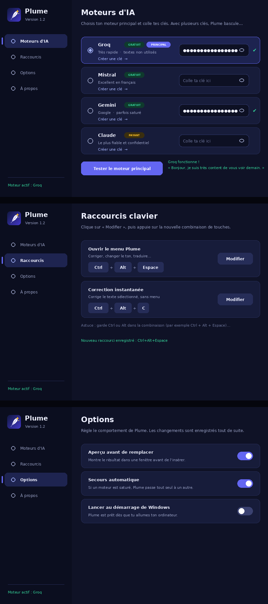

# Plume ✍️

**Assistant d'écriture personnel pour Windows**, dans l'esprit de Galaxy AI.

Sélectionne un texte n'importe où (Outlook, Gmail, WhatsApp, Word, navigateur…), appuie sur un raccourci, et Plume le corrige, améliore le vocabulaire, change le ton ou le traduit. Le résultat remplace directement ton texte.

## Fonctionnalités

- **Roue de sélection** (`Ctrl` + `Alt` + `Espace`) : 11 actions disposées en cercle autour de la souris. Clic, touche `1` à `0`, `L`, ou flèches + `Entrée`.
- **Correction instantanée** (`Ctrl` + `Alt` + `C`) : orthographe et grammaire, sans menu. Si le texte est déjà juste, Plume le dit et ne touche à rien.
- **Les actions** : corriger, améliorer le vocabulaire, ton professionnel, décontracté, poli, ferme, réseaux sociaux, raccourcir, traduire en anglais ou en français, consigne libre.
- **Aperçu** avant de remplacer, avec « Autre version » pour une nouvelle proposition.
- **Quatre moteurs d'IA** : Groq, Mistral et Gemini (gratuits), Claude (payant). Avec plusieurs clés, Plume passe tout seul à un autre moteur si l'un est saturé.
- **Fenêtre de paramètres** au thème sombre : choix du moteur, clés API, raccourcis personnalisables, options. Tout s'enregistre automatiquement.
- Les mots en wolof glissés dans une phrase sont laissés tels quels.

## Installation

1. Installe [AutoHotkey v2](https://www.autohotkey.com) (gratuit).
2. Télécharge la dernière version dans [Releases](../../releases), puis décompresse-la dans `Documents\Plume`.
3. Double-clique sur `Plume.ahk`. La fenêtre Paramètres s'ouvre : choisis un moteur et colle ta clé API.

| Moteur | Prix | Créer une clé |
|---|---|---|
| Groq | Gratuit | [console.groq.com/keys](https://console.groq.com/keys) |
| Mistral | Gratuit | [console.mistral.ai](https://console.mistral.ai/api-keys) |
| Gemini | Gratuit | [aistudio.google.com/apikey](https://aistudio.google.com/apikey) |
| Claude | Payant | [platform.claude.com](https://platform.claude.com/settings/keys) |

Le guide complet en français est dans [`LISEZMOI.txt`](LISEZMOI.txt).

## Versions

| Version | Nouveautés |
|---|---|
| [1.3](../../releases/tag/v1.3) | Roue de sélection autour de la souris |
| [1.2](../../releases/tag/v1.2) | Nouvelle fenêtre de paramètres au design moderne |
| [1.1](../../releases/tag/v1.1) | Moteurs gratuits Groq et Mistral, secours automatique |
| [1.0](../../releases/tag/v1.0) | Première version : menu, correction, aperçu, Gemini et Claude |

Le détail est dans [`CHANGELOG.md`](CHANGELOG.md).

## Confidentialité

Les clés API sont enregistrées uniquement sur ton ordinateur, dans `plume.ini`. Ce fichier n'est jamais publié dans ce dépôt.

Le texte sélectionné est envoyé au moteur d'IA choisi, et à lui seul. Avec les offres gratuites de Gemini et de Mistral, les textes envoyés peuvent servir à améliorer leurs modèles.

---

© 2026 fpapef. Tous droits réservés.
